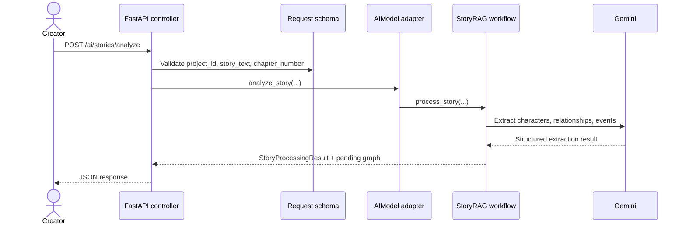

# Super Fiesta: Product Demonstration

## What the product is

Super Fiesta is an AI creative workspace for writers, illustrators, painters,
and other creative practitioners. It helps people understand and organize their
existing work, keep story details consistent, find useful references, and
develop new ideas while leaving creative decisions with the user.

The product brings together several AI workflows. It is not yet a single,
finished end-to-end application: the repository currently exposes some
workflows through a FastAPI backend, while Artist GraphRAG and Context-Aware
Suggestion are separate Python modules.

## What it does today

### For writers

- Analyze story text to identify characters, events, relationships, and
  timeline details.
- Build a structured story knowledge graph so story facts can be inspected and
  used for consistency.
- Keep the graph pending until the writer approves it.
- Generate proposed story suggestions after graph approval.
- Upload and search inspiration material to help inform later work.

Suggestions are proposals. They do not become established story facts unless
the author chooses to use them.

### For artists and visual creators

- Ingest supported reference documents and images into the inspiration
  workflow.
- Analyze and search stored inspiration to help surface relevant material.
- Use the separate Artist GraphRAG module to organize document knowledge as
  entities and relationships, then ask questions grounded in that graph.

The broader product direction is to help creators discover ideas based on
their previous work, current events, and their individual interests and style.
The current repository does **not** generate finished artwork or yet build a
personal lifestyle/style profile. Those are product goals, not demonstrated
features in this version.

## How the modules fit together

| Module | Role | Available interface today |
|---|---|---|
| Story Intelligence | Extracts story facts and proposes continuations from an approved graph. | FastAPI routes under `/ai/stories`. |
| Inspiration Ingestion | Ingests and searches creative reference material. | FastAPI upload/search routes under `/ai/projects`. |
| Artist GraphRAG | Turns PDF, DOCX, and TXT documents into a Neo4j knowledge graph and answers questions from retrieved graph context. | Python CLI and Python application interface; no REST route in this module. |
| Context-Aware Suggestion | Processes documents, extracts context, collects trend/news signals, retrieves relevant material, and generates recommendations. | Separate Python package; it is not currently exposed by the backend API. |

The Context-Aware Suggestion workflow has integrations for Gemini, Pinecone,
Google Trends, and RSS news sources. External provider access and the complete
live workflow need to be configured and verified in the running environment.
The backend's `/ai/trends` route currently returns `501`; it is not a live
trends endpoint.

## The four model layers behind the API

There are currently **three Python files** under `backend/src/models/`. To
explain the complete request-to-response path, this demonstration covers those
three files plus the Story Intelligence domain models that provide the fourth
important contract:

| Layer | Source | What it represents |
|---|---|---|
| User data contracts | `backend/src/models/user_model.py` | `UserCreate`, `UserUpdate`, and `UserOut` validate account CRUD inputs and shape safe user responses. |
| AI request contracts | `backend/src/models/ai_schemas.py` | `StoryAnalysisRequest`, `SuggestionRequest`, and `InspirationSearchRequest` validate the three JSON request bodies. Upload uses a multipart file. |
| AI application adapter | `backend/src/models/ai_model.py` | `AIModel` connects API handlers to one in-memory `StoryRAG` instance per project and coordinates analyze, approve, suggestion, and inspiration calls. It is an adapter, not a Pydantic response schema. |
| Creative domain results | `backend/modules/story_intelligence/types.py` and `models/` | `StoryInput`, `StoryProcessingResult`, extraction results, `StoryKnowledgeGraph`, and suggestion models represent the analyzed story and generated ideas. |

### AI request fields and validation

| Request schema | Fields | Validation |
|---|---|---|
| `StoryAnalysisRequest` | `project_id`, `story_text`, optional `chapter_number` | Project ID length 1–120; story text must be non-empty; chapter must be at least 1. |
| `SuggestionRequest` | `story_context`, optional `limit` | Context must be non-empty; limit defaults to 3 and must be 1–10. |
| `InspirationSearchRequest` | `query`, optional `limit` | Query must be non-empty; limit defaults to 5 and must be 1–20. |

The story-analysis result contains `project_id`, `characters`, `relationships`,
`events`, `timeline`, `knowledge_graph`, and `processing_status`. The graph
contains typed nodes and edges, an `approval_status`, and validation warnings.
Suggestion results are returned by the HTTP endpoint as a JSON array of
suggestions; each suggestion includes a title, description, type, rationale,
canonical graph references, evidence, proposed nodes/edges, guardrail findings,
and a status such as `proposed`.

The main writer request path is:



### User API contracts

The user routes provide basic MongoDB CRUD:

- `UserCreate`: `name`, `email`, `hash_pass`, and an optional `role` (`User` or
  `Admin`, default `User`). Name length is 1–100 and email is validated.
- `UserUpdate`: optional `name`, `email`, and `role` fields for `PATCH`.
- `UserOut`: returns `_id`, `name`, `email`, `role`, `created_at`, and
  `updated_at`; the stored `hash_pass` is removed from responses.

These routes are account data CRUD only. The current code does not implement
login, authorization, or password hashing, so they should not be presented as
a production-ready authentication system.

An optional API-contract example for a disposable demo database:

```http
POST /users
Content-Type: application/json
```

```json
{
  "name": "Demo Creator",
  "email": "creator@example.com",
  "hash_pass": "DEMO_ONLY_PLACEHOLDER",
  "role": "User"
}
```

Illustrative response (`201 Created`; MongoDB ID and timestamps vary):

```json
{
  "_id": "665f00000000000000000001",
  "name": "Demo Creator",
  "email": "creator@example.com",
  "role": "User",
  "created_at": "2026-11-17T12:00:00Z",
  "updated_at": null
}
```

The response omits `hash_pass`. The placeholder is not a real password hash and
must only be used in a disposable demo database.

The other user operations are `GET /users` (list up to 100 users),
`GET /users/{user_id}`, `PATCH /users/{user_id}`, and
`DELETE /users/{user_id}`. The ID must be a valid MongoDB ObjectId. A partial
update can look like this:

```http
PATCH /users/665f00000000000000000001
Content-Type: application/json
```

```json
{
  "name": "Demo Creator Updated"
}
```

The returned object follows the same `UserOut` shape. `UserUpdate.email` is a
plain optional string in the current schema, while `UserCreate.email` uses
email-format validation.

## Writer demonstration: story to suggestions

This workflow uses the backend API. Start with a short story or a chapter. The
analysis response includes extracted story structures and a knowledge graph
whose initial approval state is pending.

### 1. Analyze a story

```http
POST /ai/stories/analyze
Content-Type: application/json
```

Example request:

```json
{
  "project_id": "demo-story",
  "story_text": "Arjun entered the palace. His sister Maya was waiting for him. She revealed that Rohan, his closest friend, had secretly joined the enemy.",
  "chapter_number": 1
}
```

Review the returned characters, events, relationships, timeline, and graph.
The system keeps this graph pending so the writer can correct mistakes before
it is used as established story context.

### What the analysis response contains

The response is a `StoryProcessingResult`. It groups extracted information
under `characters`, `relationships`, `events`, and `timeline`, alongside a
`knowledge_graph` and `processing_status`. Evidence quotes help the writer see
which parts came directly from the supplied story. Inferred details are marked
as inferred by the extraction models.

The following compact example is based on the attached sample and fake test
data. It illustrates the response structure; it is **not** a live Gemini
result, and IDs and extraction details can differ on a real request.

```json
{
  "project_id": "demo-story",
  "characters": {
    "characters": [
      {
        "name": "Maya",
        "aliases": [],
        "role_in_story": "unknown",
        "description": "Arjun's sister.",
        "personality_traits": [],
        "evidence": [
          {
            "fact": "Maya is Arjun's sister.",
            "quote": "His sister Maya was waiting for him.",
            "evidence_type": "explicit"
          }
        ]
      }
    ]
  },
  "relationships": {
    "relationships": [
      {
        "source_character": "Maya",
        "target_character": "Arjun",
        "relationship_type": "SIBLING_OF",
        "description": "Maya is Arjun's sister.",
        "confidence": 1.0,
        "evidence": [
          {
            "quote": "His sister Maya was waiting for him.",
            "evidence_type": "explicit"
          }
        ]
      }
    ]
  },
  "events": {
    "events": [
      {
        "event_id": "event-001",
        "title": "Arjun enters the palace",
        "description": "Arjun enters the palace.",
        "participants": ["Arjun"],
        "location": "Palace",
        "chapter_number": 1,
        "sequence_index": 1,
        "time_reference": null,
        "chronology_basis": "narrative_order",
        "evidence": [
          {
            "quote": "Arjun entered the palace.",
            "evidence_type": "explicit"
          }
        ]
      }
    ]
  },
  "timeline": {
    "events": [
      {
        "event_id": "event-001",
        "title": "Arjun enters the palace",
        "description": "Arjun enters the palace.",
        "participants": ["Arjun"],
        "location": "Palace",
        "chapter_number": 1,
        "sequence_index": 1,
        "time_reference": null,
        "chronology_basis": "narrative_order",
        "evidence": [
          {
            "quote": "Arjun entered the palace.",
            "evidence_type": "explicit"
          }
        ]
      }
    ],
    "ordering_method": "chapter_and_sequence",
    "ordering_warnings": [],
    "chronology_verified": false
  },
  "knowledge_graph": {
    "project_id": "demo-story",
    "nodes": [
      {"id": "char-001", "node_type": "character", "label": "Arjun", "properties": {}},
      {"id": "char-002", "node_type": "character", "label": "Maya", "properties": {}},
      {"id": "event-001", "node_type": "event", "label": "Arjun enters the palace", "properties": {"chapter_number": 1}}
    ],
    "edges": [
      {
        "id": "edge-001",
        "source_id": "char-002",
        "target_id": "char-001",
        "edge_type": "SIBLING_OF",
        "directed": true,
        "confidence": 1.0,
        "evidence": ["His sister Maya was waiting for him."],
        "properties": {}
      },
      {"id": "edge-003", "source_id": "char-001", "target_id": "event-001", "edge_type": "PARTICIPATED_IN", "directed": true, "confidence": null, "evidence": [], "properties": {}}
    ],
    "approval_status": "pending",
    "validation_warnings": []
  },
  "processing_status": "completed"
}
```

The full response contains more extracted characters, relationships, events,
and graph edges than shown here. Character, relationship, event, and graph IDs
in this fixture are examples only.

### 2. Approve the story graph

After review, approve the canonical graph:

```http
POST /ai/stories/demo-story/graph/approve
```

### 3. Request continuation ideas

```http
POST /ai/stories/demo-story/suggestions
Content-Type: application/json
```

```json
{
  "story_context": "Maya has just revealed that Rohan joined the enemy. Suggest possible next events that build on this betrayal while preserving the established story facts.",
  "limit": 3
}
```

The response is a list of proposed suggestions. The writer decides whether to
adopt, edit, or ignore each idea.

### 4. Add and retrieve inspiration (optional)

Upload a previous work or reference file for this project:

```http
POST /ai/projects/demo-story/inspirations
Content-Type: multipart/form-data
```

In Swagger, choose a file in the `file` field. The endpoint accepts a file up
to 20 MB and returns an analyzed inspiration record without its numeric
embedding vector. The record can include its filename, type, extracted text,
summary, description, keywords, themes, mood tags, and provenance.

Search the stored inspiration with:

```http
POST /ai/projects/demo-story/inspirations/search
Content-Type: application/json
```

```json
{
  "query": "friendship, betrayal, and a palace setting",
  "limit": 5
}
```

Search returns matching records with similarity scores; embeddings are omitted
from the response. In this backend version, uploaded inspiration is held in
process memory and is lost when the API restarts.

> **Project ID note:** The current backend builds the graph-approval and
> suggestions routes from `GEMINI_PROJECT_ID` when the application starts. Set
> it to the same value used as `project_id` in the analysis request, then restart
> the backend. For this example, use `GEMINI_PROJECT_ID=demo-story`.

## Creative RAG demonstration: document to recommendation

The following example describes the intended Context-Aware Suggestion RAG
flow. It is an **illustrative example**, not a captured result from a live
execution or a currently available backend HTTP route.

### Example incoming request

```json
{
  "request_id": "req_001",
  "document": "cybersecurity.pdf",
  "query": "Suggest trending cybersecurity topics",
  "language": "en",
  "region": "IN"
}
```

### Internal RAG execution

1. **Document ingestion:** extract text and divide the document into chunks.
2. **Context extraction:** identify topics, keywords, entities, and a summary.
3. **Intelligence collection:** collect available trend and news signals for
   the requested region.
4. **Embedding and indexing:** create dense and sparse representations and
   store them in Pinecone when that integration is configured.
5. **Retrieval:** find relevant chunks and retain their scores and metadata.
6. **Generation:** provide the retrieved context to Gemini and generate
   recommendations.

### Illustrative final response

```json
{
  "request_id": "req_001",
  "status": "success",
  "recommendations": [
    {
      "topic": "AI-powered phishing detection",
      "reason": "Relevant to the uploaded document and current trends",
      "content_format": "LinkedIn post"
    }
  ],
  "retrieved_chunks": 8,
  "generation_provider": "gemini",
  "execution_time_ms": 2450
}
```

The example's values and response shape are for demonstration only. Actual
outputs depend on the module's configured providers and its response models.

## Artist GraphRAG demonstration

Artist GraphRAG is useful when a creator has reference documents they want to
organize and query. It extracts text, chunks it, identifies entities and
relationships with Gemini, stores the graph in Neo4j, and uses retrieved graph
context to answer questions. Its current graph retrieval is lexical/entity
based; it is not vector or hybrid retrieval.

Example questions might include:

- Identify ideas that recur across the reference documents.
- Describe relationships connecting the characters or concepts.
- Find which source document mentions a particular theme.

The example below is illustrative; the exact result depends on the ingested
documents and graph contents.

```text
Question: Which ideas recur across the reference documents?

Graph retrieval:
  Match relevant entities and relationships in Neo4j.
  Assemble context with source document and chunk references.

Gemini answer:
  Summarize the retrieved evidence and answer the question.
```

## Setup

### Requirements

- Python 3.14 or newer for the backend project.
- Gemini API key for live AI workflows.
- MongoDB connection for starting the backend API.
- Neo4j Aura credentials for Artist GraphRAG.
- Pinecone credentials for Context-Aware Suggestion vector storage.

External services are only needed for the modules being demonstrated. For
example, the writer API requires MongoDB and Gemini; the Artist GraphRAG CLI
also requires Neo4j; Context-Aware Suggestion's Pinecone workflow requires a
Pinecone key.

### 1. Configure the repository-root environment

From the repository root in PowerShell:

```powershell
if (-not (Test-Path .env)) { Copy-Item .env.example .env }
```

If `.env` already exists, keep it and edit it instead of overwriting it. Set
the relevant values in `.env`:

- `DB_URI` and `DB_NAME` for the backend's MongoDB connection.
- `GEMINI_API_KEY` for Gemini.
- `GEMINI_PROJECT_ID` to the story project ID used by the API routes.
- `NEO4J_URI`, `NEO4J_USERNAME`, `NEO4J_PASSWORD`, and `NEO4J_DATABASE` for
  Artist GraphRAG.
- `PINECONE_API_KEY` for Context-Aware Suggestion vector storage.
- Optional `STORY_MODEL`, `INSPIRATION_MODEL`, `SUGGESTION_MODEL`,
  `ARTIST_GRAPH_MODEL`, and `EMBEDDING_MODEL` values to select models.

Never commit `.env`. The checked-in `.env.example` contains placeholders only.

### 2. Create an environment and install dependencies

From the repository root:

```powershell
python -m venv .venv
.\.venv\Scripts\Activate.ps1
python -m pip install --upgrade pip
python -m pip install -e .\backend
python -m pip install -e .\backend\modules\context_aware_suggestion_pipeline
```

The backend project dependencies include the Story Intelligence, Inspiration
Ingestion, and Artist GraphRAG requirements. The second install adds the
Context-Aware Suggestion package and its additional providers.

### 3. Start the backend API

```powershell
Set-Location backend
uvicorn main:app --reload
```

Open `http://127.0.0.1:8000/docs` for the interactive API. The backend connects
to MongoDB during startup, so `DB_URI` and `DB_NAME` must be valid and the
database must be reachable. Use the Story demonstration above to analyze,
approve, and request suggestions.

### 4. Run Artist GraphRAG

From a second PowerShell terminal, enter `backend/` and check the Neo4j
connection:

```powershell
Set-Location backend
python -m modules.artist_graph_rag.src.graphrag_app.cli check
```

Ingest a PDF, DOCX, or TXT document:

```powershell
python -m modules.artist_graph_rag.src.graphrag_app.cli ingest .\path\to\reference.pdf
```

Ask a question over the graph:

```powershell
python -m modules.artist_graph_rag.src.graphrag_app.cli ask "Which themes appear in the reference?" --top-k 5
```

These CLI commands make live Gemini and Neo4j requests.

## Current boundaries

- The frontend is not implemented yet; demonstrations use Swagger, Python
  interfaces, and the Artist GraphRAG CLI.
- The FastAPI app currently exposes story analysis, graph approval, story
  suggestions, inspiration upload/search, and a placeholder trends route.
- Artist GraphRAG and Context-Aware Suggestion are not currently exposed as
  backend REST endpoints.
- AI suggestions require a reviewed and approved story graph.
- The backend keeps story workflow state and the inspiration library in
  process memory, so that state is not durable across restarts.
- Image generation and personal lifestyle/style profiling are future product
  directions, not current features.

## Suggested hackathon walkthrough (about 4 minutes)

1. **Open with the problem (30 seconds).** Creative work often grows across
   chapters, sketches, notes, and references. Important relationships and ideas
   become hard to track, and generic AI suggestions can contradict existing
   work.
2. **Show story understanding (60 seconds).** Submit the Arjun, Maya, and
   Rohan passage through `/docs`. Point out that the response separates
   characters, evidence-backed relationships, events, timeline, and graph
   nodes/edges.
3. **Show author control (30 seconds).** Explain that the extracted graph is
   pending and must be reviewed and approved before the continuation workflow
   can use it.
4. **Show idea generation (60 seconds).** Approve the graph and request up to
   three continuation ideas. Explain that ideas are marked as proposed and
   remain separate from canonical story facts.
5. **Show creative memory (45 seconds).** Upload a prior work or reference,
   then search for relevant themes. This demonstrates how personal materials
   can inform future creative work.
6. **Close with the larger vision (45 seconds).** Describe how the separate
   GraphRAG and Context-Aware Suggestion modules extend the same idea to
   reference libraries, graph-grounded questions, and trend-aware
   recommendations. Be clear that the latter modules are not yet wired into
   the backend API, and image generation/style profiling remain future work.

Use actual output from a live demo when available. The JSON examples in this
document are fixtures for explaining contracts and should not be presented as
results from a live model call.

## In one sentence

Super Fiesta helps creative people turn their stories and references into
organized, searchable context, then use that context to explore consistent,
personally relevant next ideas.
